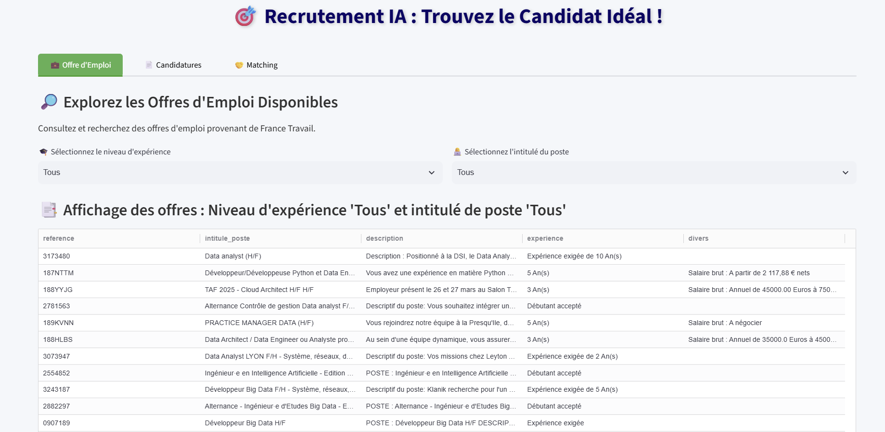
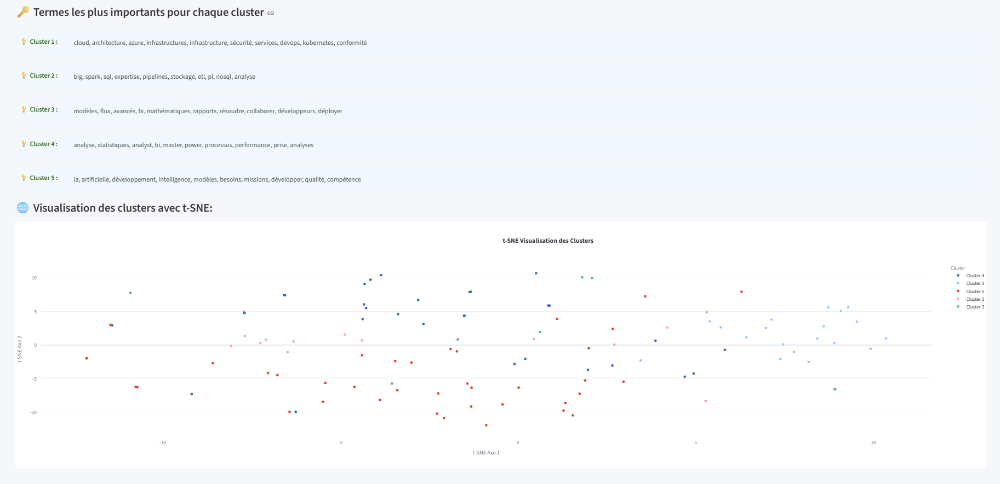
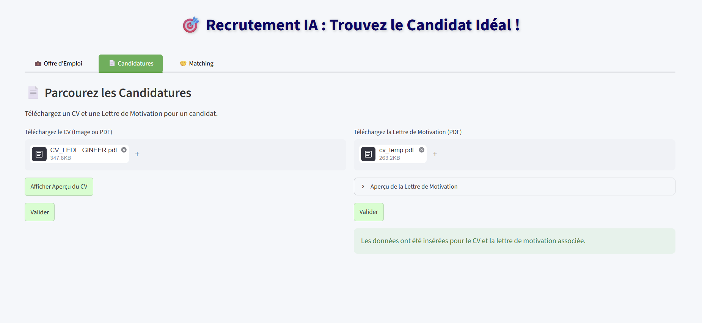
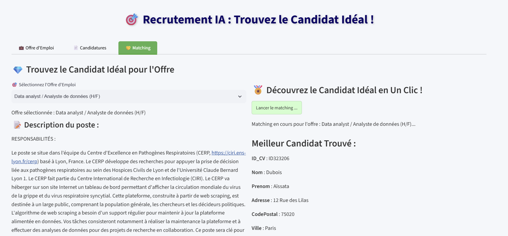

# Challenge de fin d'année : Matching CV / offres d'emploi

Dans le cadre du Master 2 SISE de l'Université Lumière Lyon 2, nous avons dû développer un projet IA de notre choix en 2 jours.

Nous avons créé une **application de matching entre offres d'emploi et CV**, en utilisant des méthodes de NLP et des LLM. Les offres d'emploi ont été collectées par scraping. L'utilisateur peut aussi **ajouter son propre CV et sa lettre de motivation** pour les comparer aux offres.


# 🚀 Installation et utilisation de l'application

Bienvenue ! Voici comment installer et utiliser cette application facilement.

---

## 📥 Prérequis

- **Docker Desktop** : assurez-vous d'avoir [Docker Desktop](https://www.docker.com/products/docker-desktop/) installé et démarré.
- Des clés API :
  - **Mistral** (obligatoire) : extraction des compétences et motivations des lettres de motivation.
  - **Hugging Face** et **Gemini** : utilisées par l'application ; `HF_TOKEN` est facultative (elle évite surtout les limitations au téléchargement des modèles).

---

## 📂 Cloner le dépôt

```bash
git clone https://github.com/Linn2d/Challenge_web_mining.git
cd Challenge_web_mining
```

---

## 🔑 Configurer les clés API

À la racine du projet, créez un fichier nommé `.env` (exactement ce nom, sans extension) :

```
HF_TOKEN=votre_cle_huggingface
MISTRAL_API_KEY=votre_cle_mistral
GEMINI_API_KEY=votre_cle_gemini
```

⚠️ Ne commitez jamais ce fichier : il est dans le `.gitignore`.

---

## 🛠️ Démarrage des conteneurs Docker

Depuis la racine du projet :

```bash
docker compose up --build
```

Docker télécharge PostgreSQL et construit l'image de l'application automatiquement. Cela lance :
- La base de données PostgreSQL
- L'application Streamlit

⏳ Le premier lancement est long (une dizaine de minutes : installation des dépendances et téléchargement des modèles). Les suivants sont beaucoup plus rapides, car Docker réutilise ce qui n'a pas changé.

Au démarrage, l'application importe les CV (CSV) et analyse les lettres de motivation (PDF) avec l'API Mistral. Si l'API répond par une limitation de débit (erreur 429), l'application réessaie automatiquement après une pause.

---

## 🌐 Accéder à l'application

Ouvrez votre navigateur : [http://localhost:8501](http://localhost:8501)

---

## **Présentation de quelques modules de l'applicationn**











## 🔄 Arrêter les conteneurs

```bash
docker compose down
```

Pour supprimer aussi les données de la base et repartir de zéro :

```bash
docker compose down -v
```

**Bonne exploration !** 📚🛠️

Notre équipe était constituée de **_Linh Nhi Le-Dinh_**, **_Daniella Rakotondratsimba_** et **_Joël Sollari_**.
